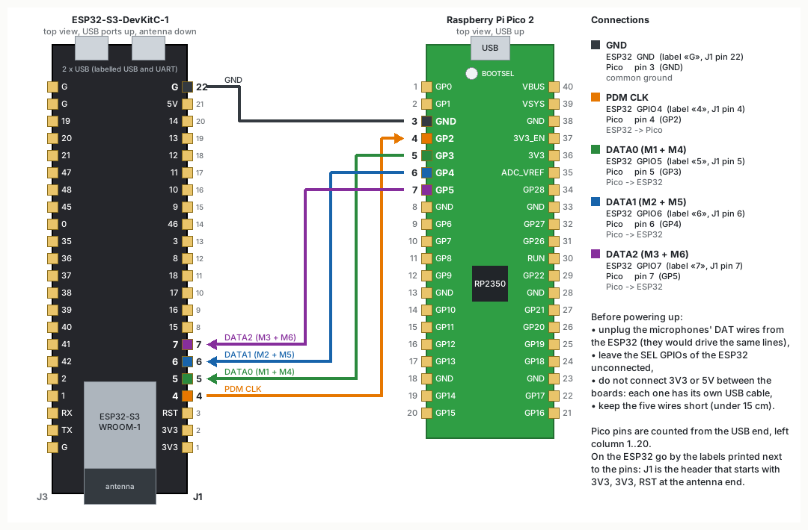
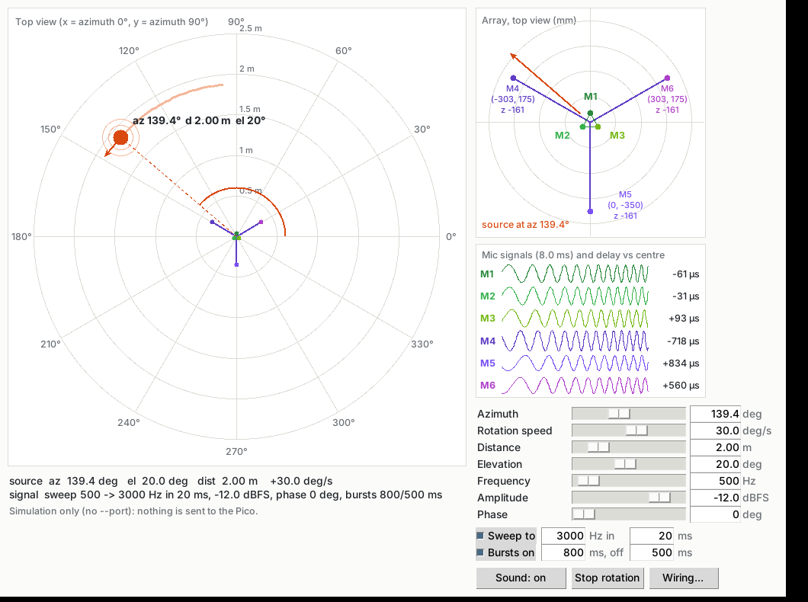

# Hardware-in-the-loop test of daq-detector with a Raspberry Pi Pico 2

A Pico 2 takes the place of the six MEMS microphones of the Audio Detection System. The ESP32-S3 runs its
normal firmware (`daq-detector`) and receives real PDM bit streams of a sound source whose position is known,
so the whole live path (PDM front end, DSP, localization, tracker, BLE) can be checked against ground truth.

```
PC: tools/live_source.py (window)  ──USB, parameters──▶  Pico 2: pico_emu firmware
        source position, signal                            synthesizes the source for 6 mics,
        ◀── azimuth in the signal now ──                   sigma-delta -> PDM on 3 data lines
                                                                │  DATA0..2      ▲ PDM CLK
                                                                ▼                │
                                                           ESP32-S3: daq-detector (unchanged)
                                                           localizes -> console / BLE / SD / USB
```

Two sources are available on the Pico:

| Mode | What is played | Tool |
|---|---|---|
| live source (`src`) | a sinusoid (tone or sweep, optional bursts) at azimuth / elevation / distance, rotating at a set speed; synthesized on the Pico, changed while it runs | `tools/live_source.py` |
| scenario (`play`) | a 6-channel WAV stored in the Pico flash (up to ~6 s, looped), e.g. the speech-like source of `tools/simulate_wav.py` | `tools/pico_scenario.py` |

## Status

First runs on hardware, 12.11.2026 (detection logs `daq-detector/recordings/det_20261112_*.csv`, ESP32 firmware
0.8.0, live source at 2 m, 30 deg/s, sweep in bursts 800 / 500 ms):

| Pico firmware | What the ESP32 log shows |
|---|---|
| 0.2.0 | Pico ran 10 % fast: burst period 1.177 s instead of 1.300 s, rotation 33.2 instead of 30 deg/s, noise floor +19 dB in the pauses. Cause: ringing on the CLK wire counted as extra clock edges (PDM bits skipped). Channel mapping correct. |
| 0.2.2 (input ignored for 75 ns after each edge) | clock locked: burst period 1.298 s, rotation 30.05–30.10 deg/s, pauses at −52 dB; time differences fit the model at elevation 0°, 2 m, azimuth within 0.7° rms of a constant-rate line. But M1..M3 and M4..M6 were exchanged (the half assignment changed in 0.2.1 was wrong for this ESP32), so the device reported no source. |
| 0.2.3 | halves as in 0.2.0, hold-off as in 0.2.2. **Not yet run.** |

Open points:
- in the 0.2.2 log the azimuth seen by the ESP32 jumps by exactly +120° about twice a minute, always during a
  pause; a jump of one data line (M1 → M2 → M3). The same log has 153 gaps in the frame counter of the ESP32.
  Whether the line shift happens in the ESP32 (lost data in the I2S receiver) or in the Pico is not known yet:
  compare `drop dma` / `drop dsp` on the ESP32 status line with `underruns` on the Pico,
- CPU load of the Pico and `--esp-port` have not been looked at on hardware.

## What you need

- ESP32-S3-DevKitC-1 with the `daq-detector` firmware (unchanged), microphones disconnected,
- Raspberry Pi Pico 2 (RP2350) and 5 jumper wires, as short as possible (under 15 cm),
- a USB cable for each board,
- Python 3.10+ with `pip install -r requirements.txt`; the window needs `tkinter` (part of the standard
  Python installer on Windows; Linux: `python3-tk`).

## Wiring

The ESP32 stays the PDM master: it drives the clock, the Pico answers on the three data lines.



| Signal | ESP32-S3-DevKitC-1 | Pico 2 | Direction |
|---|---|---|---|
| GND | any pin labelled `G` (e.g. J1 pin 22) | pin 3 (GND) | common ground |
| PDM CLK | GPIO4 (label `4`, J1 pin 4) | pin 4 (GP2) | ESP32 → Pico |
| DATA0 = M1 + M4 | GPIO5 (label `5`, J1 pin 5) | pin 5 (GP3) | Pico → ESP32 |
| DATA1 = M2 + M5 | GPIO6 (label `6`, J1 pin 6) | pin 6 (GP4) | Pico → ESP32 |
| DATA2 = M3 + M6 | GPIO7 (label `7`, J1 pin 7) | pin 7 (GP5) | Pico → ESP32 |

- The GPIO numbers are `DAQ_PIN_PDM_CLK` / `DAQ_PIN_PDM_DIN0..2` of `daq-detector/main/config.h`; the same
  drawing is in the window (**Wiring...**, or `--wiring`) and follows `--config path/to/config.h`.
- J1 is the header that starts with `3V3, 3V3, RST` at the antenna end; go by the labels printed on the board.
  Pico pins are counted from the USB end, left column 1..20.
- Unplug the DAT wires of the microphones from the ESP32, they would drive the same lines.
- The SEL GPIOs of the ESP32 (17, 18, 8, 9, 14, 21) stay unconnected: the emulator puts M1..M3 in the half
  after the rising clock edge and M4..M6 after the falling edge (measured: this is what puts M1..M3 into
  channels 1..3 of `daq-detector` 0.8.0; `swap` on the Pico exchanges the halves).
- Do not connect 3V3 or 5V between the boards; each one is powered from its own USB (or the UPS HAT).

## Firmware

**Pico 2** (once): hold BOOTSEL, plug the Pico in, copy `pico_emu/prebuilt/daq_pico_emu.uf2` to the `RP2350`
drive. Building from source: [`pico_emu/README.md`](../pico_emu/README.md).

**ESP32-S3**: the normal `daq-detector` build with ESP-IDF v5.3 or newer:

```
idf.py set-target esp32s3
idf.py build
idf.py -p <UART_PORT> flash monitor
```

On Windows run these in the "ESP-IDF CMD" window created by the ESP-IDF installer and keep the project in
a path without spaces or non-ASCII characters (e.g. `C:\esp\daq-detector`). The board starts without an SD
card (recording and `play N` are then unavailable).

## Live source window

```
python tools/live_source.py --az 0 --dist 2 --rate 30
```

The script looks for the Pico itself (USB vendor id 2E8A) and prints the port it found. If there is none it
prints `Pico not connected` and the window runs as a simulation only. `--port COM9` picks a port by hand.



- **Top view**: the six microphones (geometry of `config.h`), the source with its azimuth, distance and
  elevation, its trail and direction of rotation. The dot is filled while the burst is on.
- **Array**: close-up of the array with the mic coordinates in mm.
- **Mic signals**: the six signals over a few ms with the delay of each mic relative to the array centre.
- **Sliders and fields**: azimuth, rotation speed, distance, elevation, frequency, amplitude, phase, sweep,
  bursts. Every change is sent to the Pico at once; the fields accept values typed in (Enter).
- With the Pico connected the azimuth shown is the one the Pico reports for the signal leaving it (10 reports per
  second, advanced at the set speed in between). Without a PDM clock from the ESP32 the source stands still
  and the status line says so.

| Option | Meaning | Default |
|---|---|---|
| `--az` | start azimuth, degrees (0 = x axis, 90 = y axis, counter-clockwise seen from above) | 0 |
| `--dist` | distance from the array origin, m | 2 |
| `--rate` | rotation speed, degrees per second (negative = clockwise) | 30 |
| `--el` | elevation, degrees | 0 |
| `--freq`, `--amp`, `--phase` | sinusoid: frequency in Hz, level at the array origin in dBFS, phase in degrees | 500, −12, 0 |
| `--sweep TO_HZ PERIOD_S` | triangular sweep freq → TO_HZ → freq; `PERIOD_S` 0 = pure tone | 3000, 0.02 |
| `--burst ON_MS OFF_MS` | bursts; `OFF_MS` 0 = continuous | 800, 500 |
| `--port` | serial port of the Pico, if it should not be searched for | found automatically |
| `--no-pico` | do not look for the Pico: simulation only | — |
| `--esp-port` | UART console port of the ESP32: shows the source it reports (status line, once per second) | — |
| `--config` | `daq-detector/main/config.h` for the mic geometry and the PDM GPIOs | built-in copy |
| `--wiring` | open the wiring diagram at start | — |
| `--wav FILE`, `--seconds` | no window: write the six mic signals of this source to a WAV | — |

### Example run

Source starting at azimuth 0°, 2 m away, going round at 30 degrees per second, with the wiring diagram open:

```
> python tools/live_source.py --az 0 --dist 2 --rate 30 --wiring
Pico found on COM7
```

The window opens, the source dot moves counter-clockwise (a full turn in 12 s) and the bottom line shows the
state of the Pico, e.g. `Pico: clk 3.072 MHz (fs 48000 Hz) | src az 41.3 el 0 d 2.00 m +30.0 deg/s | cpu … | underruns 0`.
On the ESP32 console (`idf.py monitor`) the status line should then show `vad=1` during the bursts and
`src az=…` following the azimuth in the window (expected behaviour, not yet confirmed on hardware).

Without a Pico the same command prints

```
Pico not connected: no serial port of a Raspberry Pi Pico found (plug it in without BOOTSEL, with the pico_emu firmware). Running as a simulation only.
```

and the window runs on its own (status line: `Pico not connected: simulation only, nothing is sent.`).

More examples:

```
python tools/live_source.py --az 90 --dist 1.5 --rate 0 --el 20              # source standing at 90 deg, 20 deg up
python tools/live_source.py --az 0 --dist 3 --rate -60                       # clockwise, 60 deg/s
python tools/live_source.py --az 0 --dist 2 --rate 30 --freq 1000 --sweep 1000 0 --burst 800 0    # pure continuous 1 kHz tone
python tools/live_source.py --az 0 --dist 2 --rate 30 --esp-port COM5        # + the source reported by the ESP32
python tools/live_source.py --az 0 --dist 2 --rate 30 --config C:\esp\daq-detector\main\config.h   # geometry and pins of the firmware
python tools/live_source.py --az 60 --el 20 --dist 2 --rate 0 --wav data/live.wav --seconds 6      # no window: WAV
python tools/localize_wav.py data/live.wav                                   # reference algorithm on that WAV
```

### Which signal the detector can localize

The detector takes time differences from the whole 300–3500 Hz band (GCC-PHAT) and its VAD compares the
band energy with a noise floor that rises by 0.05 dB per frame. Consequences:

- a **continuous** signal is treated as voice for a few seconds only, then the floor has caught up: use bursts,
- a **pure tone** fills a few FFT bins, the PHAT-weighted rest is noise: with the reference algorithm a 1 kHz
  tone in bursts was localized in 22 of 220 voice frames, the 500 → 3000 Hz sweep (20 ms) in all 220,
- the phase of the sinusoid is common to all mics and does not change the result.

The defaults are therefore a fast sweep in bursts; a pure continuous tone can still be set (untick
*Sweep to* and *Bursts on*) to see exactly this behaviour on the device.

### Model

`daq_sim/live.py` is the specification, `pico_emu/src_synth.h` the fixed-point version on the Pico:

```
source:  P(n+1) = P(n) + f(n)/fs,   f = f0  or  f0 + (f1 - f0) tri(n / (T fs));   a(n) = A * burst gate (5 ms ramps)
mic m:   D_m(n) = (d_m(n) - dist) / c * fs + 64 samples
         x_m(n) = dist / d_m(n) * a(n - D_m) * sin(2 pi P(n - D_m) + phase)
```

`d_m(n)` is the distance from the source at azimuth `az0 + rate * n / fs` to mic m; the Doppler shift of a
moving source follows from `D_m` changing in time. One sample is 64 PDM clock cycles, so time on the Pico is
the time of the ESP32.

## Stored scenarios

```
python tools/simulate_wav.py data/sim.wav --source 60 20 2.0 --seconds 5     # speech-like source at 60 / 20 deg / 2 m
python tools/pico_scenario.py data/sim.wav --port COM9                        # load it into the Pico (stays in flash)
```

`play` on the Pico console (or power-up with a scenario in flash) loops it. Checking what the ESP32 received:

```
python tools/usb_record.py --port COM7 --out data/usb_test.wav --seconds 10   # native USB port of the DevKitC
python tools/pico_check.py data/sim.wav data/usb_test.wav                     # mapping, delays, GCC-PHAT vs the scenario
```

## First run

1. Wire the boards, plug both in, open the ESP32 console (`idf.py monitor`).
2. Open a terminal on the Pico port (`python -m serial.tools.miniterm COM9 115200 --echo`): the status line
   must show `clk 3.072 MHz`, `underruns 0` and both `cpu` loads well below 100 %. `clk none` = no clock on GP2.
3. **Channel mapping**: `tone 1` … `tone 6` on the Pico; on the ESP32 status line only the level of that mic
   may rise. If M1 and M4 (M2 / M5, M3 / M6) are exchanged, type `swap` on the Pico.
4. Close the terminal (one program per port) and start `tools/live_source.py`.
5. On the ESP32 console `vad=1` appears during the bursts and `src az=… el=… d=…` follows the window.

## Pico console

Line commands over USB serial (any baud rate); `-` in place of a number keeps the current value.

| Command | Effect |
|---|---|
| `src AZ EL DIST RATE` | live source: position (deg, deg, m) and rotation speed (deg/s) |
| `sig F0 AMP_DBFS PHASE_DEG` | sinusoid: frequency, level at the array origin, phase |
| `sweep F1 PERIOD_S` | triangular sweep F0 → F1 → F0 (`PERIOD_S` 0 = pure tone) |
| `burst ON_MS OFF_MS` | bursts (`OFF_MS` 0 = continuous) |
| `mic [N X Y Z]`, `c MPS`, `fs HZ` | mic position in mm (no arguments: list), speed of sound, sample rate |
| `telem 0\|1` | 10 lines per second `S az el dist rate gate` |
| `play`, `rewind` | play the stored scenario, from the start |
| `tone N` | 1 kHz at −20 dBFS on mic N only (0 = all) |
| `silence` | digital silence |
| `swap` | exchange the clock halves (M1..M3 ↔ M4..M6) |
| `gain DB` | −40..+12 dB on everything |
| `quiet [0\|1]`, `info`, `help` | status lines off / on, firmware and scenario, command list |

Status line, once per second:
`clk 3.072 MHz (fs 48000 Hz) | src az 123.4 el 20 d 2.00 m +30.0 deg/s | cpu 55% / 51% | underruns 0 | swap 0 gain 0 dB`

## Checks done on the PC

| Check | Result |
|---|---|
| sigma-delta + packing + receiver model on a simulated scenario (`pico_emu/test/host_test.c`, `tools/pico_check.py`) | every channel matches, delay spread 0.0001 samples, GCC-PHAT differs by 0.004 µs (median); `localize_wav.py` gives 60.0° / 20.1° / 2.01 m for a source at 60° / 20° / 2 m |
| live source: firmware code vs `daq_sim/live.py` (`pico_emu/test/src_test.c`) | within a few LSB (rms 1–5 LSB over 10 s, incl. −200 and 360 deg/s, sweep and bursts) |
| live source through the PDM model, reference algorithm A, 12 s | median azimuth error 0.04° (static), 0.08° (30 deg/s), 0.15° (−60 deg/s), 0.28° (120 deg/s); distance within 2 % |
| window against a mock of the Pico and of the ESP32 console | commands, telemetry, sound on / off and the wiring window work |

## Troubleshooting

| Symptom | Cause / fix |
|---|---|
| `could not open port` | wrong port (Bluetooth COM ports give "semaphore timeout") or a terminal still holds it; list ports with `python -m serial.tools.list_ports -v`, the Pico has `VID:PID=2E8A:…` |
| Pico shows a clock above the ESP32's (e.g. `clk 3.377 MHz` instead of 3.072) | the Pico only counts the edges it receives, so it sees extra ones: ringing on the CLK wire. Shorter wires, GND wire next to CLK, 33–100 Ω in series at the ESP32 end; firmware ≥ 0.2.2 ignores the input for 75 ns after each edge |
| Pico: `clk none` | no clock on GP2: wire GPIO4 → pin 4, common ground, ESP32 firmware running |
| ESP32 levels at the noise floor | DATA wires, or the microphones are still connected |
| M1..M3 and M4..M6 exchanged | `swap` on the Pico |
| crackling, `pico_check.py` reports a delay spread | shorter wires, 33–100 Ω in series with the CLK wire (a double-counted edge exchanges the halves) |
| Pico `underruns` rising or `cpu` near 100 % | report the status line; the system clock of the Pico can be raised (`SYS_CLOCK_KHZ` in `main.c`) |
| ESP32 `vad=0` all the time | continuous signal (use bursts) or level too low (`--amp`, `gain`) |
| ESP-IDF build fails on Windows | not in the ESP-IDF CMD window, or a path with spaces / non-ASCII characters |

## Files

| File | Purpose |
|---|---|
| `tools/live_source.py` | window: array, source, mic signals, parameters, wiring; drives the `src` mode |
| `daq_sim/live.py` | model of the live source (specification of `src_synth.h`) |
| `tools/pico_scenario.py` | WAV → Pico flash (USB upload or UF2) |
| `tools/pico_check.py` | recording received by the ESP32 vs the scenario |
| `pico_emu/main.c` | Pico firmware: pipeline (DMA ring, two cores), sources, USB console |
| `pico_emu/src_synth.h` | live source in fixed point |
| `pico_emu/pdm_core.h` | sigma-delta modulator and bit packing |
| `pico_emu/pdm_emu.pio` | PIO program: 3 bits on every clock edge |
| `pico_emu/scenario.h` | flash layout of a stored scenario |
| `pico_emu/test/` | PC runs of the firmware code (`host_test.c`, `src_test.c`) |
| `pico_emu/prebuilt/daq_pico_emu.uf2` | firmware 0.2.3 ready to copy to the Pico |
